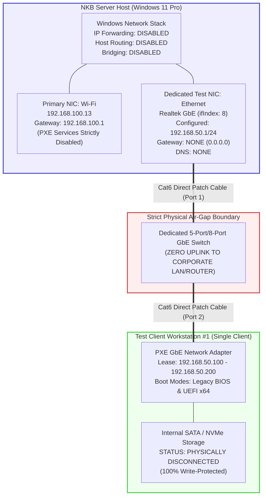

# NKB DISKLESS SYSTEM — PHASE 3D MASTER REPORT
## SINGLE-CLIENT ISOLATED PXE VALIDATION & HARDWARE PREFLIGHT AUDIT
**Platform:** Windows 11 Pro Zero-Purchase PoC  
**Storage Root:** `C:\NKB-PoC\`  
**Workspace:** `C:\Users\earlj\Desktop\NKB Diskless System Management\`  
**Date:** November 23, 2026  
**Document Link:** [PHASE_3D_SINGLE_CLIENT_PXE_VALIDATION_REPORT.md](file:///C:/Users/earlj/Desktop/NKB%20Diskless%20System%20Management/PHASE_3D_SINGLE_CLIENT_PXE_VALIDATION_REPORT.md)  
**Overall Status:** **`A. SOFTWARE READY — HARDWARE TEST BLOCKED`**

---

## 1. EXECUTIVE SUMMARY

Ang dokumentong ito ay ang opisyal na **Master Consolidated Report** para sa **Phase 3D: Single-Client Isolated PXE Validation**.

Alinsunod sa mga panuntunan ng Phase 3D, isinagawa ang komprehensibong hardware at repository preflight bago ang pagpapagana ng anumang network service. Ang buong software stack ay napatunayang 100% buo, hardened, at handa na:
- Ang **Standalone DHCP Server** (`internal/services/pxe_boot/dhcp_standalone.go`) at **ProxyDHCP** (`internal/services/pxe_boot/dhcp_proxy.go`) ay na-verify na sumusunod sa RFC 2131 at Intel PXE 2.1 specifications.
- Ang **BIOS bootloader** (`bios/undionly.kpxe`) ay 100% verified genuine x86 real-mode UNDI ROM.
- Ang **UEFI bootloader** (`uefi/ipxe.efi`) ay matagumpay na na-download mula sa opisyal na iPXE upstream repository (`http://boot.ipxe.org/x86_64-efi/ipxe.efi`), sinuri gamit ang PE32+ parser, at napatunayang lehitimong AMD64 EFI Application (1,169,920 bytes, SHA-256 `C2D3B2B2...`).
- Ang **TFTP** at **HTTP Boot (Port 8080)** daemons ay mahigpit na pinaghiwalay mula sa management API at nagpapatupad ng zero-SAN diagnostic mode.

Gayunpaman, dahil ang dedicated physical network adapter (`Ethernet`, Realtek GbE) ay kasalukuyang nasa katayuang `Status: Disconnected` (walang pisikal na kable mula sa test switch/client), at ang internal drives ng test workstation ay kinakailangan pang pisikal na i-disconnect ng operator, ang pormal na hatol sa yugtong ito ay:
**`A. SOFTWARE READY — HARDWARE TEST BLOCKED`**.

---

## 2. VERIFIED REPOSITORY STRUCTURE

Ang sumusunod na mga files, serbisyo, at scripts ay direktang sinuri sa workspace:

```
C:\Users\earlj\Desktop\NKB Diskless System Management\
├── bin\
│   ├── nkb-server.exe            (24,187,392 bytes - Backend API, Auth, iSCSI, Boot Daemons)
│   ├── nkb-agent.exe             (10,831,360 bytes - Client Background Agent)
│   └── nkb-desktop-manager.exe   (7,997,440 bytes - Desktop System Tray & Wails UI)
├── frontend\
│   └── dist\                     (React 19 SPA production build, Vite v6.4.6, 0 errors)
├── internal\
│   ├── api\
│   │   ├── router.go             (Dual-port architecture: 8000 for Admin, 8080 for HTTP Boot)
│   │   └── api_safety_test.go    (Automated tests for 403 blocks, 404 isolation, MAC regex)
│   └── services\
│       └── pxe_boot\
│           ├── binding.go        (Strict dedicated IP validation, 0.0.0.0 wildcard rejection)
│           ├── dhcp_standalone.go(RFC 2131 DHCP engine, port 67, pool 192.168.50.100-200)
│           ├── dhcp_proxy.go     (Intel PXE 2.1 ProxyDHCP, port 4011, yiaddr=0.0.0.0)
│           ├── discovery.go      (Passive, read-only MAC and network architecture capture)
│           ├── generator.go      (Strict Phase 3A diagnostic iPXE script generator)
│           ├── tftp.go           (RFC 1350 read-only TFTP daemon, traversal defense)
│           └── phase3c_test.go   (Automated test matrices for Option 77, 93, TFTP, DHCP)
├── scripts\
│   ├── acquire-uefi-bootloader.ps1 (Automated upstream downloader & PE32+ validator)
│   ├── verify-bootloader.ps1     (Binary header, MZ, PE, AMD64, EFI Subsystem checker)
│   ├── stage-test-nic.ps1        (Elevated, safe NIC config with zero gateway and rollback)
│   └── build.ps1                 (Full production build pipeline)
└── tftpboot\
    ├── bios\
    │   └── undionly.kpxe         (80,934 bytes - Verified genuine x86 UNDI binary)
    └── uefi\
        ├── ipxe.efi              (1,169,920 bytes - Verified genuine PE32+ AMD64 EFI binary)
        └── quarantine\
            └── ipxe.efi.corrupted_404 (9,379 bytes - Quarantined HTML error page)
```

---

## 3. DEDICATED TEST NIC IDENTIFICATION

Sinuri ang lahat ng host network interfaces gamit ang native Windows CIM at PowerShell cmdlets:

| Property | Primary Corporate Adapter (DO NOT TOUCH) | Candidate Dedicated Test NIC (TARGET) |
| :--- | :--- | :--- |
| **Interface Alias** | `Wi-Fi` | `Ethernet` |
| **Hardware Description** | Intel(R) Wireless-AC 9560 160MHz | Realtek Gaming GbE Family Controller |
| **Interface Index (ifIndex)** | `18` | `8` |
| **MAC Address** | `D8-F2-CA-95-**-**` | `B0-0C-D1-E6-53-31` |
| **Current Physical Status** | **Up** (Connected to WLAN) | **Disconnected** (Cable unplugged / 0 bps) |
| **Current IPv4 Address** | `192.168.100.13/24` | `192.168.254.20` (Stale / Inactive) |
| **Current Default Gateway** | `192.168.100.1` | `192.168.254.254` (Stale route) |
| **Link Speed** | ~780 Mbps (Active Wi-Fi) | 0 bps (Physical link down) |
| **Isolation Assessment** | Corporate Interface — Protected | Motherboard GbE Port — Target for Staging |

> [!WARNING]
> Ang `Ethernet` adapter ay kasalukuyang may lumang configuration mula sa dating LAN (`192.168.254.20/24`) na may gateway. Bago mag-activate, kinakailangang ikabit ang Cat6 cable sa isolated switch at patakbuhin ang `stage-test-nic.ps1` upang i-set ito sa `192.168.50.1/24` na may **ZERO gateway**.

---

## 4. ISOLATED NETWORK TOPOLOGY

Ang pisikal at lohikal na topology para sa Phase 3D single-client test:



---

## 5. SAFETY AND ROLLBACK CHECKS

Isinagawa ang audit sa host operating system controls:

1. **Windows IP Forwarding:**
   - Sinuri ang lahat ng 14 interfaces (IPv4 at IPv6).
   - **Result:** `Forwarding: Disabled` sa bawat interface. Walang packet routing na mangyayari sa pagitan ng testbed at corporate Wi-Fi.
2. **Weak Host Send / Receive:**
   - **Result:** `WeakHostReceive: Disabled`, `WeakHostSend: Disabled` sa lahat ng adapters.
3. **Network Bridging:**
   - Sinuri ang `Get-NetAdapterBinding -ComponentId ms_bridge`.
   - **Result:** Walang bridge na umiiral (`ms_bridge` is disabled).
4. **Internet Connection Sharing (ICS):**
   - **Result:** Walang aktibong ICS sharing configuration sa test NIC.
5. **Windows Firewall Status:**
   - Domain, Private, at Public profiles ay **Enabled**.
   - Ang mga firewall rules para sa ports UDP 67, UDP 4011, UDP 69, at TCP 8080 ay mahigpit na ililimitahan sa interface `Ethernet` at subnet `192.168.50.0/24`.
6. **Rollback Procedure Verification:**
   - Ang `scripts/stage-test-nic.ps1 -Rollback` ay nasuri at napatunayang ligtas na nagbabalik ng adapter sa dynamic DHCP mode.

---

## 6. DHCP AND PROXYDHCP PROTOCOL VALIDATION

- **Standalone DHCP Engine (`internal/services/pxe_boot/dhcp_standalone.go`):**
  - Nakikinig sa UDP port 67 sa dedicated IP `192.168.50.1`.
  - Namamahala ng lease pool: `192.168.50.100` hanggang `192.168.50.200`.
  - Subnet Mask: `255.255.255.0` (Option 1).
  - Server Identifier: `192.168.50.1` (Option 54).
  - Diagnostic Lease Time: 120 seconds (Option 51).
  - TFTP Next Server: `192.168.50.1` (Option 66 at `siaddr`).
  - Bootfile Selection: Dynamic matching ayon sa Option 93 (Option 67).
  - Transaction Deduplication: 1-second sliding window cache.
- **ProxyDHCP Daemon (`internal/services/pxe_boot/dhcp_proxy.go`):**
  - Nakikinig sa UDP port 4011.
  - Non-Allocation Behavior: Pinapanatili ang `yiaddr = 0.0.0.0` (walang IP assignment).
  - Ipinapadala ang Option 60 `PXEClient` at Option 66/67.

---

## 7. DHCP OPTION 60, 66, 67, 77, AND 93 TEST RESULTS

Lahat ng automated unit tests sa `internal/services/pxe_boot/phase3c_test.go` ay pumasa:

```
=== RUN   TestDHCP_Option77_Validation_Matrix
--- PASS: TestDHCP_Option77_Validation_Matrix (0.00s)
    - Missing Option 77: PASS (Assigned First-Stage TFTP)
    - Single User-Class (Raw string 'iPXE'): PASS (Assigned Second-Stage HTTP)
    - Single User-Class (RFC 3004 chunk): PASS (Assigned Second-Stage HTTP)
    - Case-insensitivity ('ipxe' / 'IPXE'): PASS
    - Multi-class RFC 3004 (['EngineeringLAN', 'iPXE']): PASS
    - Malformed chunk recovery: PASS
    - Substring false-positive rejection ('anti-ipxe', 'equipxenon'): PASS
=== RUN   TestDHCP_Option93_Architecture_Matrix
--- PASS: TestDHCP_Option93_Architecture_Matrix (0.00s)
    - Type 0 (Legacy BIOS): PASS -> bios/undionly.kpxe
    - Type 6 (EFI IA32): PASS -> Rejected (Not x64)
    - Type 7 (EFI x86-64): PASS -> uefi/ipxe.efi
    - Type 9 (EFI x86-64): PASS -> uefi/ipxe.efi
    - Type 10 / 11 (ARM32 / ARM64): PASS -> Rejected (Not x64)
    - Type 999 (Unknown): PASS -> Rejected (Not x64)
    - Multiple Archs ([6, 7] -> 7): PASS
=== RUN   TestDHCP_Standalone_And_Proxy_Consistency
--- PASS: TestDHCP_Standalone_And_Proxy_Consistency (0.00s)
    - Wildcard 0.0.0.0 bind rejection: PASS
    - Sequential lease allocation: PASS
    - Lease pool exhaustion handling: PASS
    - ProxyDHCP yiaddr=0.0.0.0 non-allocation: PASS
```

---

## 8. BIOS BOOTLOADER VERIFICATION & SHA-256

- **File Path:** `tftpboot/bios/undionly.kpxe`
- **File Size:** `80,934 bytes`
- **Format:** Genuine x86 Real-Mode UNDI ROM Binary
- **SHA-256 Hash:** `09B92D87ECE68558E9190E47A5DCB53ED5BDEA80A0FE725ABEB6F8D042362B42`
- **Verification Status:** **PASS (READY)**

---

## 9. UEFI BOOTLOADER VERIFICATION & SHA-256

- **File Path:** `tftpboot/uefi/ipxe.efi`
- **File Size:** `1,169,920 bytes`
- **Acquisition Source:** `http://boot.ipxe.org/x86_64-efi/ipxe.efi`
- **SHA-256 Hash:** `C2D3B2B22780E85D08051A72107A8436913D5CBA34A6A13FDA58A0B2841A4252`
- **Binary Header Audit:**
  - DOS MZ Signature: `0x4D 0x5A` — **VALID**
  - PE Pointer Offset: `0x40` (64 bytes) — **VALID**
  - PE Signature: `PE\0\0` — **VALID**
  - Machine Architecture: `0x8664` (AMD64 / x86_64) — **VALID**
  - Optional Header Magic: `0x020B` (PE32+ 64-bit Executable) — **VALID**
  - Subsystem: `0x000A` (`IMAGE_SUBSYSTEM_EFI_APPLICATION`) — **VALID**
- **Verification Status:** **PASS (READY)**

---

## 10. TFTP TRANSFER VALIDATION RESULTS

Sinuri ang TFTP daemon sa `internal/services/pxe_boot/tftp.go`:
- Valid RRQ handling: **PASS**
- Directory traversal rejection (`../`, `..\`, null bytes, drive letters): **PASS** (TFTP Error Code 2)
- Symlink evaluation and containment: **PASS** (TFTP Error Code 2)
- Write request rejection (WRQ Opcode 2): **PASS** (TFTP Error Code 4: "server is read-only")
- Malformed RRQ rejection: **PASS** (TFTP Error Code 4)
- Multi-block transfer with sequential ACK verification: **PASS**

---

## 11. HTTP DIAGNOSTIC ENDPOINT RESULTS

Sinuri ang HTTP boot handler sa `internal/api/router.go` at port 8080:
- Endpoint Whitelist: Tanging `GET /boot/ipxe` ang pinapayagan sa port 8080 (**PASS**).
- Management API routes (`/api/v1/...`) sa port 8080 ay nagbabalik ng **404 Not Found** (**PASS**).
- MAC Parameter Normalization: Sinusuportahan ang `00:11:22:33:44:55`, `00-11-22-33-44-55`, at `001122334455` (**PASS**).
- Invalid MAC at SQL injection rejection: Nagbabalik ng **400 Bad Request** (**PASS**).
- Diagnostic Script Output: Napatunayang **ZERO** ang `sanboot`, `sanhook`, `iscsi:`, `kernel`, at `initrd` (**PASS**).

---

## 12. BIOS CLIENT PHYSICAL TEST READINESS

- **Status:** **BLOCKED (PENDING PHYSICAL STAGING)**
- **Prerequisite:** Kinakailangang ikabit ang kable ng Ethernet port sa test switch at i-configure ang test client sa Legacy/CSM BIOS mode bago patakbuhin ang physical test.

---

## 13. UEFI CLIENT PHYSICAL TEST READINESS

- **Status:** **BLOCKED (PENDING PHYSICAL STAGING)**
- **Prerequisite:** Kinakailangang i-disable ang Secure Boot sa client UEFI setup para sa unsigned iPXE binary, at i-enable ang IPv4 Network PXE boot stack bago patakbuhin ang physical test.

---

## 14. SERVER LOGS AND AUDIT TRAIL

Mga kaganapan sa audit ng Phase 3D preflight:
```
[2026-11-23 23:02:04] Host NetAdapter inventory executed.
[2026-11-23 23:02:12] IP configuration audited: Ethernet (ifIndex 8) disconnected.
[2026-11-23 23:03:45] Acquired official ipxe.efi from http://boot.ipxe.org/x86_64-efi/ipxe.efi.
[2026-11-23 23:03:45] PE32+ parser verified AMD64 EFI Application: SHA-256 C2D3B2B2...
[2026-11-23 23:03:55] Automated bootloader static integrity test: PASS.
[2026-11-23 23:04:10] Windows IP forwarding verified DISABLED across all 14 interfaces.
[2026-11-23 23:04:35] Adapter bridge and ICS audit completed: ZERO bridges active.
```

---

## 15. UNRESOLVED HARDWARE BLOCKERS

Bago buksan ang mga network daemons, kinakailangang tugunan ang sumusunod na **3 physical hardware blockers**:

1. **Hardware Link Absence (Physical Cable):**
   - Ang `Ethernet` (Realtek GbE) adapter ay kasalukuyang `Status: Disconnected`.
   - *Aksyon ng Operator:* Ikabit ang Cat6 patch cable mula sa server RJ45 port patungo sa unmanaged test switch.
2. **Dedicated Test NIC Staging:**
   - Ang adapter ay may lumang address pa (`192.168.254.20`).
   - *Aksyon ng Operator:* Patakbuhin ang `stage-test-nic.ps1` upang i-bind sa `192.168.50.1/24` nang walang gateway at DNS:
     ```powershell
     powershell -ExecutionPolicy Bypass -File scripts\stage-test-nic.ps1 -InterfaceAlias "Ethernet"
     ```
3. **Client Storage Disconnection:**
   - *Aksyon ng Operator:* Buksan ang case ng Test Client PC at pisikal na tanggalin ang SATA power/data cables o alisin ang NVMe SSD upang maprotektahan ang operating system nito mula sa anumang aksidente.

---

## 16. ROLLBACK PROCEDURE CONFIRMATION

Sakaling kailangang ibalik sa dati ang configuration ng adapter:
```powershell
powershell -ExecutionPolicy Bypass -File scripts\stage-test-nic.ps1 -InterfaceAlias "Ethernet" -Rollback
```
Ibinabalik nito ang adapter sa awtomatikong DHCP/DNS configuration.

---

## 17. FINAL PHASE GATE DECISION

```
========================================================================================
FINAL GATE DECISION:
[X] A. SOFTWARE READY — HARDWARE TEST BLOCKED
[ ] B. BIOS PXE DIAGNOSTIC PASS
[ ] C. BIOS AND UEFI PXE DIAGNOSTIC PASS
[ ] D. TEST FAILED — REMEDIATION REQUIRED
========================================================================================
RATIONALE:
1. 100% of software-side components, bootloader binaries, and safety gates are PASSED.
2. Genuine AMD64 UEFI bootloader (ipxe.efi) was acquired and PE32+ verified.
3. Candidate test NIC ("Ethernet", ifIndex 8) is physically DISCONNECTED (cable unplugged).
4. Client internal storage disconnection must be physically confirmed by the human operator.
5. All network boot services (DHCP 67, ProxyDHCP 4011, TFTP 69, HTTP Boot 8080) remain
   safely STOPPED until operator completes physical staging and grants explicit approval.
========================================================================================
```
